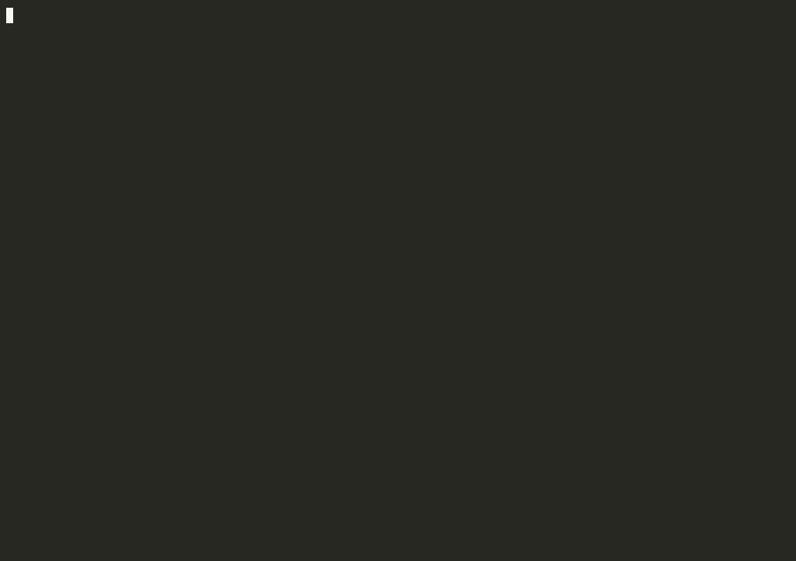

# commit-trail

commit-trail is a terminal application that follows each file's changes across a set of GitHub pull requests. It answers two review questions:

1. How does this file change across the selected PRs?
2. Does a later PR already change code that I might flag while I review an earlier PR?

The file is the main unit of navigation. You select a file, step through the commits that changed it, and read each diff with its PR. commit-trail complements [tuicr](https://github.com/agavra/tuicr): commit-trail shows the history, and tuicr writes and submits review comments.



The demo runs `commit-trail 778 780` in a clone of [agavra/tuicr](https://github.com/agavra/tuicr). To record it again, run `scripts/record-demo.sh`.

## Requirements

- macOS or Linux (x64 or arm64).
- Git 2.29 or later.
- The [GitHub CLI](https://cli.github.com) (`gh`), signed in with `gh auth login`.
- Optional: [tuicr](https://github.com/agavra/tuicr), for the `o` and `O` keys.
- Optional: [delta](https://github.com/dandavison/delta), for diffs rendered by delta (`brew install git-delta`).
- For a source installation only: [Bun](https://bun.sh) 1.3 or later.

## Installation

### Install with Homebrew

The repository is its own Homebrew tap. The formula is `Formula/commit-trail.rb`.

1. Add the tap:

   ```bash
   brew tap anthonyokc/commit-trail https://github.com/anthonyokc/commit-trail
   ```

2. Install the latest release:

   ```bash
   brew install anthonyokc/commit-trail/commit-trail
   ```

3. Verify the installation:

   ```bash
   commit-trail --version
   ```

To install the newest commit on `main` instead of the latest release, run `brew install --HEAD anthonyokc/commit-trail/commit-trail`.

To upgrade, run `brew update`, then run `brew upgrade commit-trail`.

Homebrew builds commit-trail from source. The formula downloads a pinned Bun release for the build and does not install a Bun formula, so it works with any existing Bun installation. It installs `gh` as a runtime dependency.

### Install from source

1. Clone the repository and install the dependencies:

   ```bash
   git clone https://github.com/anthonyokc/commit-trail.git
   cd commit-trail
   bun install
   ```

2. Choose one of these options:

   - Link the `commit-trail` command to the source tree. Bun then runs the TypeScript source directly:

     ```bash
     bun link
     ```

   - Build a standalone executable at `dist/commit-trail`, then copy it to a directory on your `PATH`:

     ```bash
     bun run build
     cp dist/commit-trail ~/.local/bin/
     ```

The standalone executable contains the Bun runtime and the OpenTUI native library. It does not require Bun at run time.

## Usage

Run commit-trail inside a clone of a GitHub repository.

### Select pull requests

| Command | Selected PRs |
|---|---|
| `commit-trail` | The open PR of the current branch, plus the PRs stacked with it |
| `commit-trail 1` | PR #1, plus every open PR that changes one of PR #1's files |
| `commit-trail 1:12` or `commit-trail 1-12` | PRs #1 through #12, inclusive |
| `commit-trail 1 2 3 8 10` | Exactly these PRs. Commas also separate numbers: `1,2,3` |

With no arguments, commit-trail finds the open PR whose head branch is the current branch. It adds PRs that target that branch or that the branch targets, and PRs whose head commits are ancestors or descendants of it. It does not add unrelated open PRs. If no open PR uses the current branch, commit-trail stops and asks for PR numbers.

If a number in a range has no pull request, commit-trail reports that it skipped the number and loads the others.

With one PR number, commit-trail runs in focus mode. The file list shows only the focus PR's files. Press `a` to show the files of every loaded PR.

### Keys

| Key | Action |
|---|---|
| `j` / `k` | Select the next or previous file |
| `h` / `l` | Move backward or forward through the selected file's changes |
| `Enter` | Show the full diff of the selected change |
| `e` | In the preview or the diff view, show 10 more hidden lines at each end of every hidden region |
| `E` | In the preview or the diff view, show the whole file. Press `E` again to return to the changes |
| `J` / `K` | Scroll the preview in the selected change panel |
| `t` | In the diff view, switch the diff renderer: pierre, delta (if installed), built-in |
| `D` | Open the selected diff in a pager: delta in delta mode, Git's pager otherwise |
| `Esc` | Return to the file history, or clear the search |
| `p` | Switch between the commit timeline and the PR timeline |
| `a` | In focus mode, switch between the focus PR's files and all files |
| `o` | Open the selected change's PR in tuicr (`tuicr pr <number>`) |
| `O` | Open the selected commit in tuicr, limited to the file |
| `/` | Search file paths |
| `r` | Write a Markdown report for the selected change's PR |
| `R` | Write a Markdown report for all loaded PRs |
| `y` | Copy the last report to the clipboard. If no report exists, commit-trail first creates one for the selected PR |
| `?` | Show the key list and the load notes (skipped PRs, stale branches, warnings) |
| `q` | Quit |

The mouse also works:

- Click a file in the file list to select it.
- In the selected change panel, click a commit under "Earlier changes", "Later changes", or "Parallel" to select that change. Click elsewhere in the panel to open the full diff view.
- In the preview or the full diff view, click a `Show` action on a `⋯ N hidden lines` row to reveal hidden lines.
- Scroll the preview or the full diff view with the wheel.

While commit-trail captures the mouse, most terminals select text when you hold Shift (Option in iTerm2) while you drag.

The timeline contains only the commits that change the selected file. If a file appears in 30 commits and 4 of them change it, the timeline has 4 nodes. The PR timeline (`p`) combines each PR's commits into one node and shows the combined diff.

Changes on separate branches appear in separate lanes. Git defines no order between lanes, so the "Parallel" line lists those changes separately from earlier and later changes.

The `r` and `R` keys write reports to the system temporary directory, in `commit-trail/`. To use a different directory, start commit-trail with `--report-dir <path>`.

### Diffs

The selected change panel shows a short preview of the diff, with 2 unchanged lines around each change. The full diff view (`Enter`) shows 5 unchanged lines. The `preview_context_lines` and `context_lines` settings change these numbers. The preview and the full diff view each keep their own expansion. In both, `e` reveals 10 more lines at each end of every hidden region, and `E` shows the whole file. A preview longer than the panel scrolls with the wheel or `J`/`K`, and marker rows count the lines above and below.

Instead of Git's `@@ -12,2 +12,3 @@ tar_option_set(` header, each hunk starts with a heading such as `Lines 12–14 · tar_option_set(`. The heading uses the new file's line numbers. The text after `·` is the nearest earlier line that Git recognizes as a function or section name. With pierre, a `⋯ 27 hidden lines   ↓ Show 10 lines below   ↑ Show 10 lines above   Show all 27` row stands for each hidden region, including the region after the last change. The directions refer to the neighboring changes. Click `↓ Show 10 lines below` to reveal the lines just below the change above the row, `↑ Show 10 lines above` to reveal the lines just above the change below the row, or `Show all` to reveal the whole region. The region at the start of the file offers only `↑`, and the region after the last change offers only `↓`. A region with 10 or fewer hidden lines offers one `Show N lines` action. delta and the built-in renderer show the hidden-line count only, and `e`/`E` add Git context lines instead.

Diffs use one of three renderers:

- pierre (default): commit-trail parses the patch with [@pierre/diffs](https://diffs.com) and highlights it with [Shiki](https://shiki.style), inside commit-trail. It shows line numbers and `+`/`-` markers, tints added and removed lines, and marks the changed words. At 120 columns or more, it shows old and new lines side by side. It needs no other program. The `pierre_theme` setting selects the Shiki theme.
- delta: commit-trail sends the patch to `delta --paging=never` at the panel's width and shows delta's colored output in the panel. delta reads its settings from your Git config, so options such as `side-by-side`, `line-numbers`, and `features` apply. This renderer requires delta, and it keeps delta's own hunk headers.
- built-in: commit-trail colors the unified diff without syntax highlighting.

In the preview, pierre and delta omit the file header, because the panel already names the file.

To choose a renderer, set `diff` in the config file or start commit-trail with `--diff`. Press `t` to switch renderers while commit-trail runs. If pierre or delta fails, commit-trail shows the built-in diff and the error in the footer.

The first pierre diff of each language takes about one second, while Shiki loads the grammar. Later diffs take a few milliseconds.

The `D` key suspends commit-trail and opens the selected diff in a pager. commit-trail resumes when you quit the pager.

- In delta mode, `D` runs `git -c core.pager='delta --paging=always' show <commit> -- <file>`. delta's navigation keys (`n`, `N`) and search work there.
- In pierre and built-in mode, `D` runs `git show <commit> -- <file>` with the pager from your Git config.
- In the PR timeline, `D` shows `git diff` from before the PR's first commit to its last commit.
- commit-trail adds `-+F` to `LESS`, so `less` stays open when the diff fits on one screen. Your other `LESS` options stay in effect.

### Generate a report without the interface

| Command | Report |
|---|---|
| `commit-trail report 1` | PR #1, compared with every open PR that changes one of its files |
| `commit-trail report 1 --against 1:12` | PR #1, compared with PRs #1 through #12 |
| `commit-trail report 1:12` | The file histories of PRs #1 through #12 |

The report goes to standard output. To write a file, add `-o report.md`. To copy the report to the clipboard, add `--copy`. The clipboard copy uses `pbcopy`, `wl-copy`, `xclip`, `xsel`, or `clip.exe` (WSL).

A focus report has a summary table and one section for each file of the focus PR. Each section shows the focus PR's diff and then each other PR's change to the file, with one finding:

| Finding | Meaning |
|---|---|
| File overlap | Another PR modifies the file, but not lines next to the focus PR's lines. |
| Code overlap | Another PR edits lines next to the focus PR's lines, or the focus PR edits lines from an earlier PR. |
| Potentially superseded change | A later PR removes or replaces lines that the focus PR introduced. |

A report never claims that a later change resolves a review concern. It shows the evidence for that decision.

### Options

| Option | Effect |
|---|---|
| `-C`, `--repo <path>` | Use the repository at `<path>` instead of the current directory |
| `--remote <name>` | Fetch PR commits from this Git remote. The default is the remote whose URL names the GitHub repository |
| `--no-fetch` | Do not run `git fetch`. PRs whose head commits are missing locally are skipped |
| `--offline` | Read GitHub metadata from the cache only. Implies `--no-fetch` |
| `--refresh` | Ignore cached PR commit lists and read them from GitHub again |
| `--cache-dir <path>` | Store the cache in `<path>`. The default is `$XDG_CACHE_HOME/commit-trail`, or `~/.cache/commit-trail` |
| `-o`, `--output <file>` | `report` only: write the Markdown report to `<file>` |
| `--copy` | `report` only: copy the Markdown report to the clipboard |
| `--max-diff-lines <n>` | Show at most `n` diff lines for each patch in a report. The default is 60 |
| `--report-dir <path>` | Write reports from the `r` and `R` keys to `<path>` |
| `--diff <renderer>` | Diff renderer for the preview, the full diff view, and the `D` key: `pierre`, `delta`, or `builtin`. This option overrides the config file. `delta` stops with an error if delta is not on `PATH` |
| `--context <n>` | Show `n` unchanged lines around each change in the full diff view. This option overrides the config file |
| `--config <path>` | Read settings from `<path>` instead of the default config file |

### Configuration

commit-trail reads settings from `$XDG_CONFIG_HOME/commit-trail/config.toml`. If `XDG_CONFIG_HOME` is not set, the path is `~/.config/commit-trail/config.toml`. If the file does not exist, commit-trail uses the defaults.

```toml
# Diff renderer: "pierre", "delta", or "builtin".
# "delta" stops with an error if delta is not on PATH.
diff = "pierre"

# Shiki theme for the pierre renderer, for example "catppuccin-mocha" or "github-dark".
pierre_theme = "catppuccin-mocha"

# Unchanged lines around each change: full diff view, then the selected change panel.
context_lines = 5
preview_context_lines = 2
```

| Setting | Values | Default |
|---|---|---|
| `diff` | `"pierre"`, `"delta"`, `"builtin"`. `"auto"` is accepted and means `"pierre"` | `"pierre"` |
| `pierre_theme` | A [Shiki theme name](https://shiki.style/themes), or `"pierre-dark"` or `"pierre-light"` | `"pierre-dark"` |
| `context_lines` | A whole number from 0 to 1000 | `5` |
| `preview_context_lines` | A whole number from 0 to 1000 | `2` |

A command-line option overrides the matching setting. An unknown setting or an invalid value stops commit-trail with an error that names the file.

## How commit-trail builds the history

commit-trail reads PR metadata and commit lists from GitHub through `gh`. It reads ancestry, changed files, renames, patches, and blame from the local Git repository. It never checks out a PR branch.

### What commit-trail changes

commit-trail does not change your branches, your working tree, or GitHub. It writes in two places:

- If a PR's head commit is missing locally, commit-trail runs `git fetch --no-write-fetch-head <remote> pull/<number>/head`. This command adds commit objects to the repository. It does not create or move any branch or ref. Use `--no-fetch` to prevent it.
- commit-trail stores GitHub metadata in its cache directory. The cache indexes each PR's commit list by the PR's head commit SHA. When a PR branch changes, its head SHA changes, and commit-trail reads the new commit list from GitHub.

### Assign commits to the PR that introduced them

GitHub lists inherited commits in stacked PRs. If PR #10 targets `main` but its branch starts from PR #9's branch, GitHub lists the commits of PRs #1 through #9 in PR #10. commit-trail removes those inherited commits from PR #10:

1. PR `q` is a predecessor of PR `p` if `q`'s head commit is an ancestor of `p`'s head commit, or if `p` targets `q`'s head branch.
2. Each commit has candidates: the PRs that list it, plus predecessors whose branches contain it.
3. A candidate with a predecessor among the other candidates did not introduce the commit. commit-trail removes it.
4. If one candidate remains, it owns the commit. If several remain, the commit is ambiguous. The interface marks an ambiguous owner as `#4?/#7?`.

commit-trail loads every open PR's head commit for this step, so attribution works even when you select only some PRs of a stack. Commits that belong to an unselected PR do not appear.

A rebase can leave old copies of a predecessor's commits in a stacked branch. commit-trail compares patch IDs (`git patch-id --stable`). If a commit repeats the patch of a commit in a predecessor PR, commit-trail hides the copy and reports the stale branch. If two unrelated PRs contain the same patch, as after a cherry-pick, the interface lists the other commit under "Same patch also in".

### Classify overlap

For each change, commit-trail runs `git blame` on the commit's first parent for the lines in each diff hunk. A removed line from an earlier commit counts as replaced. An unchanged context line from an earlier commit counts as adjacent. The finding for a later change then follows from the focus PR's lines that it touches.

A change is later than the focus PR's change if one of the focus PR's commits for the file is its ancestor. It is earlier if it is an ancestor of one of those commits. Otherwise it is parallel.

### Rename tracking

Git's rename detection (`-M`) links a file's old and new paths. commit-trail shows the history under the newest path and lists the other paths.

## Limitations

- GitHub returns at most 250 commits for one PR. Commits after the first 250 do not appear.
- commit-trail loads at most 500 open PRs as attribution context.
- Merge commits do not appear in file histories. The load notes report how many merge commits commit-trail skipped.
- A rebase that changes a patch (for example, a conflict resolution) produces a new patch ID. commit-trail then treats the old copy as a separate change.
- Rename tracking joins histories by path. If a path is deleted and later reused for a different file, both files share one history.
- The "Hunk context" text comes from Git's function-name detection. For some languages it shows the nearest line that starts with a letter, not a function name.

## Development

```bash
bun install
bun test            # unit and integration tests; the tests create temporary Git repositories
bun run typecheck   # TypeScript type check
bun run start -- 1  # run from source, with arguments after --
```

### Release a new version for Homebrew

1. Choose the next version with [semantic versioning](https://semver.org): increase the patch number for a fix, the minor number for a new feature, and the major number for an incompatible change. Update `version` in `package.json`.
2. Update the `tag` and `version` values in `Formula/commit-trail.rb`. To change the Bun version that builds the release, update the four Bun `url` and `sha256` pairs from the Bun release's `SHASUMS256.txt` file.
3. Commit the changes, then create and push the tag:

   ```bash
   git tag v0.3.0
   git push origin main v0.3.0
   ```

4. Test the formula:

   ```bash
   brew update
   brew reinstall anthonyokc/commit-trail/commit-trail
   brew test commit-trail
   ```

## License

MIT. See [LICENSE](LICENSE).
